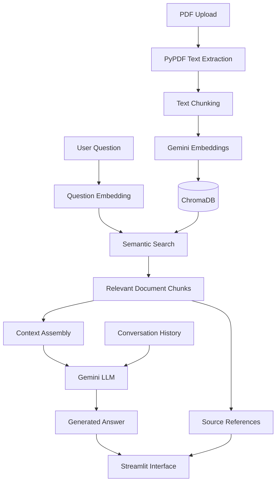
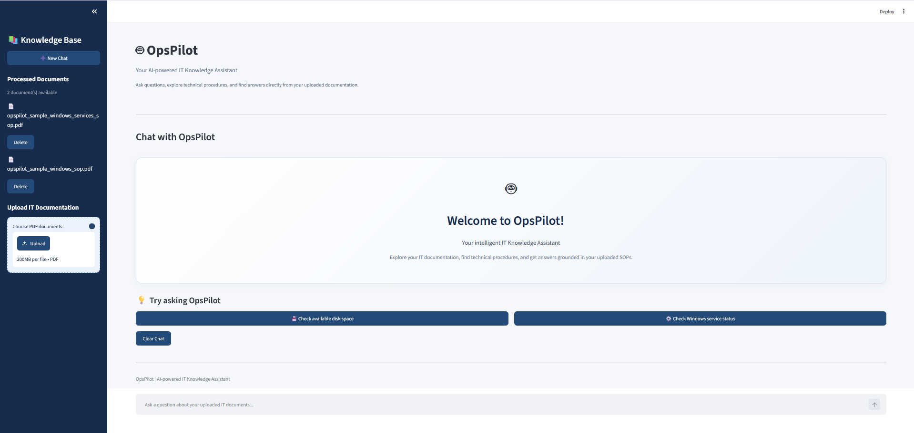
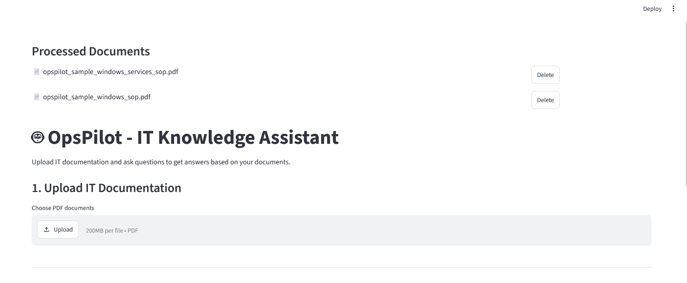
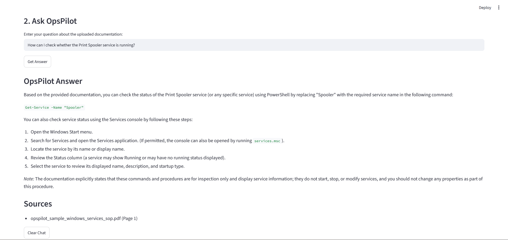

# OpsPilot – AI-Powered IT Knowledge Assistant

## 1. Project Overview

OpsPilot is a Retrieval-Augmented Generation (RAG) application that helps users retrieve information from technical documentation and Standard Operating Procedures (SOPs).

Users can upload multiple PDF documents and ask questions in natural language. OpsPilot uses semantic search to retrieve relevant document sections and Google's Gemini models to generate answers grounded in the retrieved content.

The application also provides source document names and page references to support answer verification.

## 2. Problem Statement

IT teams frequently work with technical documentation, troubleshooting guides and operational procedures. Finding specific information across multiple documents can be time-consuming.

OpsPilot addresses this challenge through document-based semantic search and AI-powered question answering, helping users find relevant information more efficiently.

## 3. Key Features

- Multiple PDF document uploads.
- PDF text extraction using PyPDF.
- Text chunking with configurable chunk size and overlap.
- Semantic embeddings using Google's Gemini Embedding API.
- Persistent vector storage using ChromaDB.
- Similarity-based document retrieval.
- Context-grounded answer generation using Gemini.
- Source references with document names and page numbers.
- Relevance threshold for filtering retrieved content.
- Fallback responses for unsupported questions.
- Conversation history and contextual follow-up questions.
- Clear conversation functionality.
- Duplicate document detection using SHA-256 hashing.
- API error handling for quota limits and temporary service outages.
- Retrieval evaluation using separate test scripts.

## 4. Technology Stack

| Technology | Purpose |
|---|---|
| Python | Application development |
| Streamlit | User interface |
| Google Gemini | LLM-based answer generation |
| Gemini Embedding API | Semantic text embeddings |
| ChromaDB | Persistent vector database |
| PyPDF | PDF text extraction |
| python-dotenv | Environment variable management |

## 5. System Architecture

OpsPilot follows a Retrieval-Augmented Generation architecture with two main workflows.

### Document ingestion

1. Users upload PDF documents.
2. PyPDF extracts text from each document.
3. Extracted text is divided into smaller overlapping chunks.
4. Gemini generates embeddings for the chunks.
5. ChromaDB stores the embeddings, text and source metadata.

### Question answering

1. The user submits a natural-language question.
2. Gemini generates an embedding for the question.
3. ChromaDB performs semantic similarity search.
4. Relevant document chunks are retrieved.
5. Retrieved content is assembled into context.
6. The context is passed to Gemini.
7. Gemini generates a document-grounded response.
8. OpsPilot displays the answer and source references.

### Architecture Diagram



## 6. Project Workflow

PDF Upload → Text Extraction → Chunking → Embedding Generation → ChromaDB Storage → Semantic Retrieval → Context Assembly → Gemini Answer Generation → Source Display

## 7. Installation and Setup

### Prerequisites

- Python
- Google Gemini API key
- Git

### Clone the repository

```bash
git clone https://github.com/ritika-builds280/opspilot-rag.git
cd opspilot-rag
```

### Create a virtual environment

```bash
python -m venv .venv
```

### Activate the environment

Windows PowerShell:

```powershell
.\.venv\Scripts\Activate.ps1
```

Windows Command Prompt:

```cmd
.venv\Scripts\activate.bat
```

### Install dependencies

```bash
pip install -r requirements.txt
```

### Configure the API key

Create a `.env` file in the project root:

```text
GEMINI_API_KEY=your_api_key_here
```

Never commit the `.env` file or expose your API key.

### Run the application

```bash
streamlit run app.py
```

Open the local Streamlit address displayed in the terminal.

## 8. Evaluation and Testing

OpsPilot includes separate scripts for retrieval evaluation and metric-based assessment.

The evaluation test set covers:

- Direct technical questions.
- Questions with different wording.
- Specific technical queries.
- Out-of-scope questions.
- Questions involving procedures not covered by the documentation.

### Run retrieval evaluation

```bash
python evaluate_retrieval.py
```

### Run retrieval metrics evaluation

```bash
python evaluate_metrics.py
```

The evaluation scripts use manually labelled relevant document chunks to assess retrieval performance using Precision@3 and Recall@3.

Initial experiments demonstrated successful retrieval for disk-space and Windows service-related questions, along with rejection of unrelated queries.

The evaluation dataset is currently limited and the relevance threshold is provisional. Further evaluation across a larger document collection is required.

## 9. Error Handling and Limitations

- Gemini API quota limits may affect answer generation.
- Temporary Gemini service outages may interrupt responses.
- Retrieval quality depends on document quality, chunking and relevance filtering.
- Scanned PDFs may require OCR support.
- Information mentioned in a document does not necessarily mean the complete procedure is documented.
- The application requires further testing before production use.

## 10. Future Enhancements

- Improved document-grounded answer validation.
- Expanded retrieval evaluation and quality metrics.
- Support for additional document formats.
- OCR support for scanned PDFs.
- Improved conversational interface.
- More robust API retry and recovery mechanisms.
- Cloud deployment and hosted persistent storage.
- Enhanced multi-document retrieval.

## 11. Project Status

OpsPilot is a personal Generative AI portfolio project demonstrating the practical implementation of Retrieval-Augmented Generation using Python, Google Gemini, ChromaDB and Streamlit.

It is intended for learning and demonstration purposes and is not a production IT operations system.

## 12. Author

Developed as a personal Generative AI portfolio project.


---

## Screenshots

### 1. OpsPilot Home Dashboard


### 2. PDF Document Upload


### 3. AI-Generated Answer with Source References

